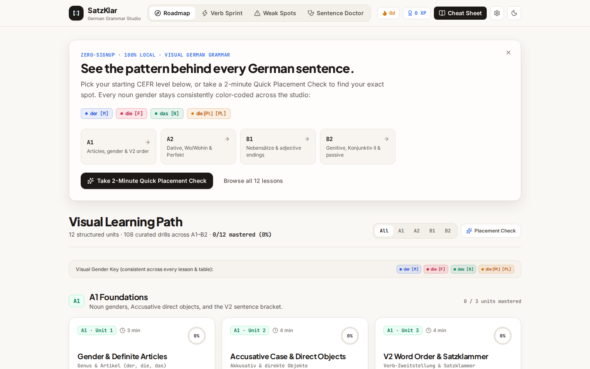

# SatzKlar — Interactive German Grammar Studio (A1–B2)

> **Zero-friction, open-source visual German grammar studio.** Turn `der/die/das`, *Wechselpräpositionen*, *Satzklammer* word order, and verb conjugation into visual patterns—100% locally in the browser with **zero mandatory API keys**.



## Why SatzKlar?

- **Consistent Visual Gender & Case Encoding:** Every noun across every lesson, popover, and grammar table uses the same color + color-blind-accessible badge system:
  - **Masculine (`der`):** Royal Blue `#2563EB` `[M]`
  - **Feminine (`die`):** Rose Red `#E11D48` `[F]`
  - **Neuter (`das`):** Emerald Green `#059669` `[N]`
  - **Plural (`die [Pl.]`):** Amber Gold `#D97706` `[PL]`
- **Show "Why", Not Just "Wrong":** Every answer unlocks an instant **Rule Pill** explaining the exact grammatical trigger (e.g., *Preposition 'mit' always triggers Dative → Masculine 'der' becomes 'dem'*).
- **Zero-Config Open-Source First:** Clone, install, and start learning immediately—all 12 units (108 curated exercises), spaced repetition, German `de-DE` audio (Web Speech API), and the offline Sentence Doctor run 100% client-side.

## Features

| Feature | What It Does |
| :--- | :--- |
| **Visual Learning Path (A1–B2)** | 12 structured CEFR units with mastery rings, estimated durations, and **1-Minute Cheat Sheets** before every drill. |
| **5 Interactive Exercise Modes** | Case & Article Drills (with clickable noun gender hints), **Satzklammer** Word-Tile Puzzle, **Wechselpräpositionen** (`Wo?` vs. `Wohin?`) Simulator, **Spot & Fix** Error Correction, and **60s Verb Sprint**. |
| **Native `de-DE` Audio** | One-click `1.0×` normal and `0.75×` slow playback via `window.speechSynthesis` (works offline, press `Space`). |
| **Smart Mistake Vault (SRS)** | Automatically captures missed rules for targeted spaced-repetition review until answered right twice in a row. |
| **Quick-Reference Grammar Drawer** | Slide-over cheat sheet (Articles, Prepositions, Satzklammer/TeKaMoLo, Adjectives) accessible mid-drill without resetting quiz state. |
| **AI Sentence Doctor (BYOK)** | Instant offline German heuristic checker (capitalization, V2 inversion, subordinate verb-end, prepositions, `haben/sein`) + optional **Gemini API key** in Settings for deep explanations and natural B1/B2 rewrites. |
| **Keyboard-First & Portable** | Full keyboard shortcuts (`1–4`, `Enter`, `Space`, `Backspace`, `Esc`), Warm Paper Light & Low-Glare Slate Dark modes, and **JSON Export/Import** backups. |

## Quick Start (3 Steps)

```bash
git clone https://github.com/Gunu2/satzklar.git
cd satzklar
npm install && npm run dev
```

Open the local URL printed by Vite and start learning immediately—no account, database, or API key needed.

## How to Contribute New Lessons

All curriculum content is cleanly decoupled into JSON files inside `src/data/lessons/`:

```text
src/data/lessons/
├── a1-01-gender-articles.json
├── a1-02-accusative-objects.json
├── a1-03-verb-second-satzklammer.json
├── a2-01-dative-case.json
├── a2-02-wechselpraepositionen.json
├── a2-03-perfekt-past-tense.json
├── b1-01-subordinate-clauses.json
├── b1-02-adjective-declension.json
├── b1-03-praeteritum-modals.json
├── b2-01-genitive-prepositions.json
├── b2-02-konjunktiv-ii.json
└── b2-03-passive-voice-clauses.json
```

To add a new lesson (e.g., a C1 unit or a specialized A2 drill):

1. Create a new JSON file in `src/data/lessons/` (e.g., `c1-01-nominalisierung.json`) following the schema documented in [CONTRIBUTING.md](./CONTRIBUTING.md).
2. Register the import in `src/data/index.ts`.
3. Run `npm run build` to verify TypeScript validation passes cleanly, then open a Pull Request!

## Tech Stack

- **React 19 + TypeScript + Vite**
- **Tailwind CSS v4**
- **Lucide Icons**
- **Web Speech API (`de-DE`)** & `localStorage` persistence

## License

MIT License — see [LICENSE](./LICENSE).
